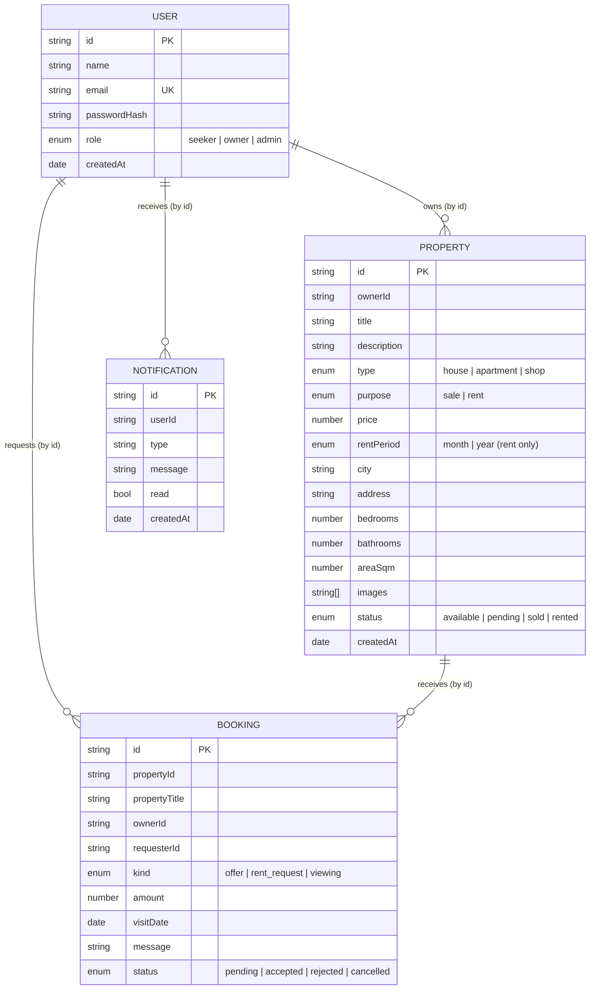
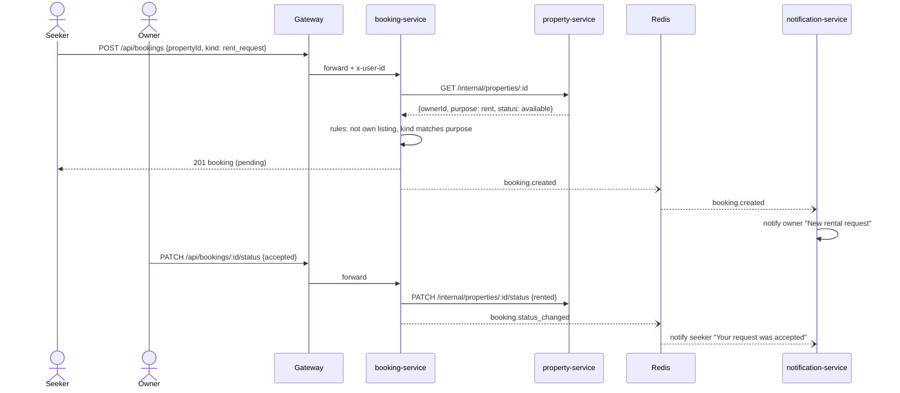
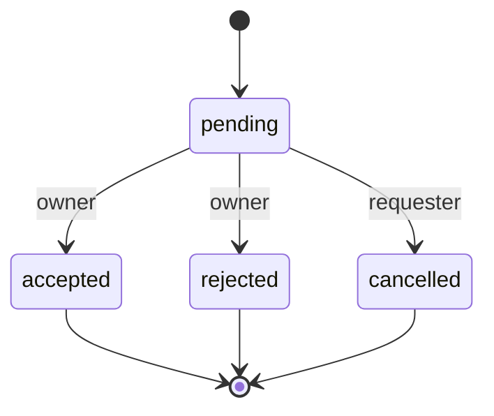

# Nestar — Architecture Design

## 1. Style: microservices

Each service owns **one business capability** and **its own database**. No service reads another service's database. They talk in two ways:

- **Synchronous REST** – the browser only talks to the **API Gateway**, which forwards to the right service. Services occasionally call each other over HTTP (e.g. booking-service asks property-service whether a listing exists and who owns it).
- **Asynchronous events** – services publish domain events (`user.registered`, `property.created`, `booking.created`, `booking.status_changed`) on a Redis pub/sub bus. The notification-service subscribes and builds each user's inbox. Nobody waits on it, so a slow notification never slows a booking.

## 2. System diagram

```mermaid
flowchart LR
    U[👤 User<br/>browser] --> FE[React SPA<br/>Vite :5173]
    FE -->|HTTPS /api/*| GW[API Gateway :8080<br/>JWT check · rate limit · CORS · routing]

    GW -->|/api/auth| AUTH[auth-service :4001]
    GW -->|/api/properties| PROP[property-service :4002]
    GW -->|/api/bookings| BOOK[booking-service :4003]
    GW -->|/api/notifications| NOTI[notification-service :4004]

    AUTH --- DB1[(nestar_auth)]
    PROP --- DB2[(nestar_property)]
    BOOK --- DB3[(nestar_booking)]
    NOTI --- DB4[(nestar_notification)]

    BOOK -->|GET /internal/properties/:id| PROP

    AUTH -. user.registered .-> BUS{{Redis pub/sub}}
    PROP -. property.created .-> BUS
    BOOK -. booking.created / status_changed .-> BUS
    BUS -. subscribe .-> NOTI
```

(Rendered PNG/SVG sources: [`diagrams/architecture.mmd`](diagrams/architecture.mmd))

## 3. Services

| Service | Owns | Key endpoints | Publishes | Subscribes |
|---|---|---|---|---|
| **api-gateway** | nothing (stateless) | `/api/*`, `/health` | – | – |
| **auth-service** | users, password hashes, roles | register, login, me | `user.registered` | – |
| **property-service** | listings (house/apartment/shop, sale/rent) | CRUD, search | `property.created`, `property.updated`, `property.deleted` | – |
| **booking-service** | offers, rent requests, viewing requests | create, list mine, list incoming, change status | `booking.created`, `booking.status_changed` | – |
| **notification-service** | notifications inbox | list, mark read | – | all of the above |

### Why these boundaries?
- They change for different reasons (login rules vs. listing fields vs. deal workflow).
- They scale differently (search traffic on property-service is 10–50× higher than bookings).
- A crash in notifications must not stop people from posting listings.

## 4. Cross-cutting concerns

| Concern | How |
|---|---|
| Authentication | auth-service issues a **JWT** (`sub`, `role`, `name`). Gateway verifies it and forwards `x-user-id`, `x-user-role`, `x-user-name` headers. Services also verify the token themselves (defence in depth) using the shared secret. |
| Authorization | Role checks (`owner` to post listings) + ownership checks (only the listing owner can edit or accept a request). |
| Validation | Each service validates its own input with small schema helpers in `@nestar/common`. |
| Errors | One JSON error shape everywhere: `{ "error": { "code": "NOT_FOUND", "message": "..." } }`. |
| Config | 12-factor: everything from environment variables, defaults for local dev. |
| Health | Every service exposes `GET /health`. Docker Compose uses it for healthchecks. |
| Observability | Structured JSON logs with request id (`x-request-id` added by the gateway). |
| Resilience | Gateway timeouts; booking-service handles property-service being down with a `503`; events are fire-and-forget. |

## 5. Data model



Relations across services are **by id only** — there are no foreign keys between databases. booking-service copies `ownerId` and `propertyTitle` when the booking is created so it can answer "requests on my listings" without calling property-service every time (a deliberate, small denormalization).

## 6. Main flow — "Seeker rents an apartment"



## 7. Booking status rules



When an **offer** is accepted the property becomes `sold`; when a **rent_request** is accepted it becomes `rented`. A **viewing** being accepted doesn't change the property.

## 8. Deployment view

- **Local:** `docker compose up` → 5 Node containers + frontend + MongoDB + Redis.
- **Production (suggested):** each service as its own container (Render/Fly/Railway or Kubernetes), MongoDB Atlas with one database per service, Upstash Redis, frontend on Vercel/Netlify pointing at the gateway URL.
