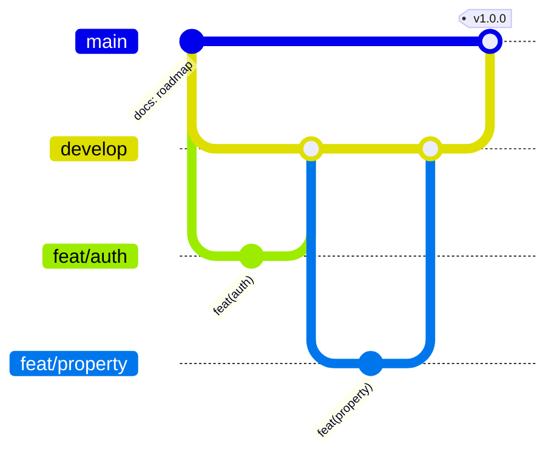

# Nestar — Git & GitHub Workflow

## Branches

```
main      ← always deployable. Only merged from develop via PR. Protected.
develop   ← integration branch. Feature PRs land here.
feat/*  fix/*  docs/*  chore/*  test/*   ← short-lived, one per task
```



## Commit messages — Conventional Commits

`type(scope): short summary in present tense`

| type | use for |
|---|---|
| `feat` | a new feature |
| `fix` | a bug fix |
| `docs` | documentation only |
| `test` | adding / fixing tests |
| `chore` | tooling, deps, scripts |
| `build` / `ci` | Docker, GitHub Actions |
| `refactor` | code change that isn't a fix or feature |

Good: `fix(booking): prevent two requests being accepted for the same listing`
Bad: `fixed stuff`, `update`, `asdf`

---

## Push this project to GitHub — step by step

### 1. Make sure your commits will count as *your* contributions

GitHub only puts a commit on your contribution graph if the commit's email matches an email on your GitHub account.

```bash
git config --global user.name  "Your Name"
git config --global user.email "you@example.com"   # same email as on GitHub
```

This repo was prepared with the placeholder author `Nestar Team <team@nestar.dev>`. To make the existing history yours, run this **once, before your first push**:

```bash
git rebase -r --root --exec "git commit --amend --no-edit --reset-author"
```

### 2. Create an empty repository on GitHub

**Website:** github.com → **New repository** → name `nestar` → *don't* tick "Add README" (we already have one) → **Create**.

**or CLI:**

```bash
gh auth login
gh repo create nestar --public --source=. --remote=origin --description "Buy, sell or rent houses, apartments and shops — microservices"
```

### 3. Push

```bash
git remote add origin https://github.com/<your-username>/nestar.git   # skip if gh created it
git push -u origin main
git checkout -b develop && git push -u origin develop
git tag -a v1.0.0 -m "Nestar v1.0.0 – MVP" && git push origin v1.0.0
```

### 4. Set up the repo for teamwork

1. **Settings → Branches → Add rule** for `main`: require a pull request, 1 approval, and status check **CI / test** to pass.
2. **Settings → Collaborators** → invite teammates.
3. **About** (gear icon on the repo page): add a description, topics `microservices nodejs react mongodb real-estate`, and the demo URL once deployed.
4. **Issues → Labels**: add `good first issue`, `help wanted`, `service:auth`, `service:property`, `service:booking`, `service:notification`, `frontend`.
5. **Projects → New project → Board**: columns *Backlog / In progress / Review / Done* — paste the roadmap phases in as items.
6. **Releases → Draft a new release** from tag `v1.0.0` with a short changelog.

### 5. Everyday contribution loop

```bash
git checkout develop && git pull
git checkout -b feat/image-upload
# …code + tests…
npm test
git add -p                          # review what you're committing
git commit -m "feat(property): upload images to S3-compatible storage"
git push -u origin feat/image-upload
gh pr create --base develop --fill  # or open the PR on github.com
```

After review & green CI → **Squash and merge** → delete the branch.

### Contributing to someone else's repo (fork flow)

```bash
gh repo fork owner/nestar --clone
cd nestar
git checkout -b fix/typo-in-readme
# …change…
git commit -am "docs: fix typo in README"
git push -u origin fix/typo-in-readme
gh pr create --repo owner/nestar --base develop --fill
```

Keep your fork fresh: `git fetch upstream && git rebase upstream/develop`.
