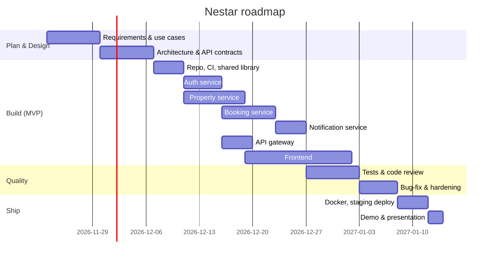

# Nestar — Project Roadmap

A realistic plan for a small team (2–4 developers) over about **12 weeks**. Each phase ends with something you can demo.

---

## Phase 0 — Idea & scope (week 1)

**Goal:** agree what we're building and what we're *not* building yet.

- Problem: property seekers jump between agencies, Facebook groups and classifieds; owners can't easily see who's serious.
- MVP scope: listings (house / apartment / shop) for **sale** or **rent**, search & filters, offers / rental requests / viewing requests, notifications, owner dashboard.
- Out of scope for v1: online payment, chat, maps API, reviews, mobile app.
- Deliverables: problem statement, user personas, this roadmap.

## Phase 1 — Requirements & use cases (week 1–2)

- Identify actors: Guest, Seeker (buyer/tenant), Owner (seller/landlord/agent), Admin.
- Write use cases and the diagram → [USE_CASES.md](USE_CASES.md).
- Non-functional requirements: p95 API latency < 300 ms, services deploy independently, passwords hashed, JWT auth, 80%+ test coverage on business logic.

## Phase 2 — Architecture & design (week 2)

- Split the domain into services by **business capability** → [ARCHITECTURE.md](ARCHITECTURE.md).
- Database-per-service; communication = sync REST via gateway + async events on Redis.
- Define API contracts → [API.md](API.md).
- Agree folder layout → [FOLDER_STRUCTURE.md](FOLDER_STRUCTURE.md).
- Wireframes for: Home/search, Listing detail, Post listing, Dashboard, Login/Register.

## Phase 3 — Foundation (week 3)

- Monorepo with npm workspaces, ESLint, Prettier, `.editorconfig`.
- `@nestar/common` shared library: config, errors, JWT middleware, validation, repositories, event bus.
- GitHub Actions CI running tests on every pull request.
- Docker Compose with MongoDB + Redis.

## Phase 4 — Backend services (weeks 4–6)

| Order | Service | Done when |
|---|---|---|
| 1 | auth-service | register, login, `/me`, roles, tests green |
| 2 | property-service | CRUD, search filters, pagination, owner-only edits |
| 3 | api-gateway | routing, JWT check, rate-limit, CORS, health |
| 4 | booking-service | offers / rent requests / viewings, status workflow |
| 5 | notification-service | consumes events, inbox per user, mark-read |

## Phase 5 — Frontend (weeks 6–8)

- React + Vite, React Router, a small `api.js` client.
- Pages: Home & search, Listing detail, Login/Register, Post listing, Dashboard (my listings, requests in/out, notifications).

## Phase 6 — Testing & quality (weeks 9–10)

- Unit tests for business rules (status transitions, ownership checks).
- Integration tests per service with Supertest (in-memory repositories).
- End-to-end smoke test through the gateway.
- Formal code review; findings and fixes logged in [CODE_REVIEW.md](CODE_REVIEW.md).

## Phase 7 — Deployment (week 11)

- Build images per service, push to a registry (GitHub Container Registry).
- Staging on a single VM with Docker Compose, or on Render / Railway / Fly.io.
- Managed MongoDB (Atlas) and Redis (Upstash) for production.

## Phase 8 — Launch & presentation (week 12)

- Demo script, slides, retrospective.

## After v1 — what's next

1. Image upload to S3-compatible storage (MinIO locally).
2. Map search (Leaflet + OpenStreetMap).
3. In-app chat service (WebSocket).
4. Payments for deposits (Stripe / Toss Payments).
5. Kubernetes + Helm, centralized logging (Loki), tracing (OpenTelemetry).
