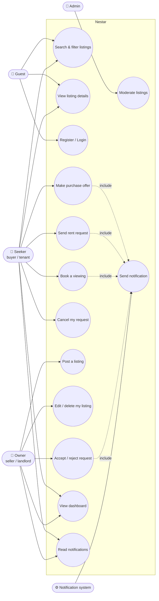

# Nestar — Use Cases

## Actors

| Actor | Who | Can do |
|---|---|---|
| **Guest** | anyone not logged in | browse & search listings, view details, register, login |
| **Seeker** | buyer or tenant (role `seeker`) | everything a guest can + make offers, send rent requests, book viewings, cancel own requests, read notifications |
| **Owner** | seller, landlord or agent (role `owner`) | everything a seeker can + post / edit / delete own listings, accept / reject incoming requests |
| **Admin** | platform staff (role `admin`) | edit or remove any listing (moderation) |
| **System** | notification-service | notifies users when things happen |

## Use-case diagram

Mermaid has no native UML use-case diagram, so here are both a Mermaid version (renders on GitHub) and the PlantUML source ([`diagrams/use-case.puml`](diagrams/use-case.puml)) for a classic UML picture.

> Inheritance: **Seeker** inherits Guest's use cases; **Owner** inherits Seeker's (an owner can also rent somewhere else); **Admin** inherits Owner's.

## Main use cases (detailed)

### UC1 — Search & filter listings
- **Actor:** Guest / Seeker / Owner
- **Flow:** user opens Home → chooses Buy / Rent, type (house / apartment / shop), city, price range, min bedrooms → sees paginated results, newest first.
- **Alternate:** no results → friendly empty state.

### UC3 — Register / Login
- **Flow:** user enters name, email, password (≥ 8 chars) and chooses "I want to find a place" (seeker) or "I want to list a place" (owner) → account created → JWT returned → logged in.
- **Errors:** email already used → `409`; wrong password → `401` (same message for wrong email, so we don't leak which emails exist).

### UC8 — Post a listing
- **Actor:** Owner
- **Pre:** logged in with role `owner`.
- **Flow:** fill title, description, type, purpose (sale/rent), price (+ rent period if rent), city, address, bedrooms, bathrooms, area, image URLs → listing published with status `available` → `property.created` event.
- **Errors:** seeker tries → `403`; invalid fields → `400` with details.

### UC4/5/6 — Make offer / rent request / viewing
- **Actor:** Seeker (or an owner acting as a seeker on someone else's listing)
- **Pre:** listing exists and is `available`.
- **Rules:**
  - cannot request on your own listing;
  - `offer` only on **sale** listings, `rent_request` only on **rent** listings, `viewing` on any;
  - `offer` needs an `amount > 0`; `viewing` needs a future `visitDate`;
  - only one *pending* request of the same kind per user per listing.
- **Post:** booking `pending`; owner notified.

### UC10 — Accept / reject request
- **Actor:** Owner of the listing
- **Flow:** dashboard → "Requests on my listings" → Accept or Reject.
- **Post:** status changes; requester notified; accepted offer → listing `sold`, accepted rent request → listing `rented`.
- **Errors:** not the owner → `403`; already decided → `409`.

### UC7 — Cancel my request
- **Actor:** the requester, only while `pending`.

### UC12 — Read notifications
- **Flow:** bell icon / dashboard shows unread count → open → mark as read.
